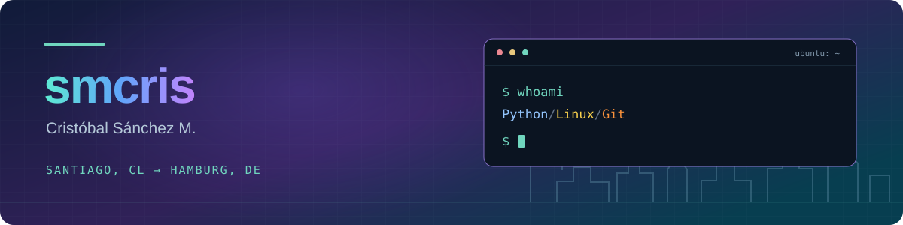
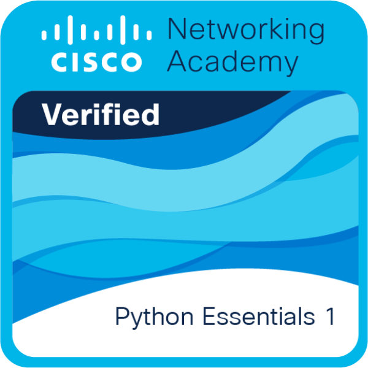

# Hola, Ich bin Cris 👋 !

[🇬🇧 English](#hola-ich-bin-cris--) · [🇩🇪 Deutsch](#hallo-ich-bin-cris-)

**Cristóbal Ignacio Sánchez Mardones**, although most people call me **Cris**. I'm originally from Santiago, Chile and currently living in Hamburg, Germany 🇨🇱🇩🇪

> 🎯 **I'm looking for an Ausbildung zum Fachinformatiker in Hamburg, starting in 2027.**

I've always been curious about how computers work, from PC hardware and operating systems to the code behind everyday tools. I'm learning from home with online courses, documentation and projects on GitHub, with structured courses alongside independent practice.

I learn best by trying things: writing small programs, using the terminal, making mistakes and figuring out how to fix them. Here I share what I'm working on.

## What I'm exploring 🌱

- **Python:** learning through exercises and small projects
- **Linux, Git & GitHub:** working with development tools and version control
- **Interests:** IT fundamentals, automation and AI

## Courses & credentials

**[Python Essentials 1](https://www.credly.com/badges/aa5b4306-264d-4bfe-bfcf-1bbcf4779fe6/public_url)** — Cisco Networking Academy · completed 18 October 2026  
**Python Essentials 2** — in progress

## A project I'm working on 🛠️

**IA-Hub** is my learning project where I keep my Python exercises and small experiments.

I'm using what I learn to build small programs, including [ConcenTrack](https://github.com/smcriss/IA-Hub/blob/main/projects/concentrack.py), a small terminal program for recording study sessions.

Over time, I'd like to turn it into a personal hub for AI tools and everyday automation.

Outside tech, I enjoy video games, training, martial arts and learning languages. I speak Spanish and English, and I'm continuing to improve my German 🇪🇸🇬🇧🇩🇪

**Contact**

---

# Hallo, ich bin Cris 👋

[🇬🇧 English](#hola-ich-bin-cris--) · [🇩🇪 Deutsch](#hallo-ich-bin-cris-)

Ich heiße **Cristóbal Ignacio Sánchez Mardones**, aber die meisten nennen mich **Cris**. Ich komme aus Santiago, Chile und lebe zurzeit in Hamburg 🇨🇱🇩🇪

> 🎯 **Ich suche einen Ausbildungsplatz zum Fachinformatiker in Hamburg ab 2027.**

Ich war schon immer neugierig darauf, wie Computer funktionieren — von PC-Hardware und Betriebssystemen bis hin zum Code hinter alltäglichen Anwendungen. Ich lerne zu Hause mit Online-Kursen, Dokumentationen und Projekten auf GitHub. Dabei verbinde ich strukturierte Kurse mit selbstständigen Übungen.

Ich lerne am besten, indem ich Dinge ausprobiere: kleine Programme schreibe, mit dem Terminal arbeite, Fehler mache und herausfinde, wie ich sie beheben kann. Hier zeige ich, woran ich arbeite.

## Woran ich gerade lerne 🌱

- **Python:** Lernen durch Übungen und kleine Projekte
- **Linux, Git & GitHub:** Arbeiten mit Entwicklungswerkzeugen und Versionskontrolle
- **Interessen:** IT-Grundlagen, Automatisierung und KI

## Kurse & Nachweise

**[Python Essentials 1](https://www.credly.com/badges/aa5b4306-264d-4bfe-bfcf-1bbcf4779fe6/public_url)** — Cisco Networking Academy · abgeschlossen am 18.10.2026  
**Python Essentials 2** — in Bearbeitung

## Ein Projekt, an dem ich arbeite 🛠️

**IA-Hub** ist mein Lernprojekt. Dort sammle ich meine Python-Übungen und kleinen Experimente.

Mit dem Gelernten schreibe ich kleine Programme, darunter [ConcenTrack](https://github.com/smcriss/IA-Hub/blob/main/projects/concentrack.py), ein kleines Terminalprogramm zum Erfassen von Lernsitzungen.

Mit der Zeit möchte ich daraus einen persönlichen Hub für KI-Werkzeuge und Automatisierung im Alltag machen.

Außerhalb der IT mag ich Videospiele, Sport, Kampfsport und das Lernen von Sprachen. Ich spreche Spanisch und Englisch und verbessere weiterhin mein Deutsch 🇪🇸🇬🇧🇩🇪

**Kontakt**

